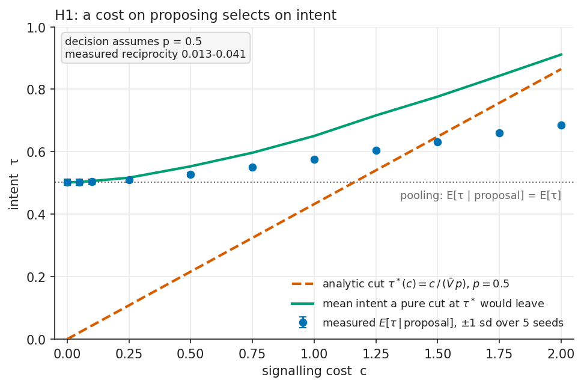
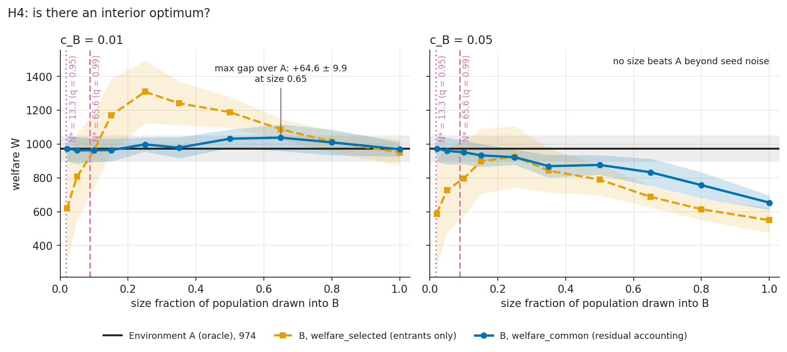
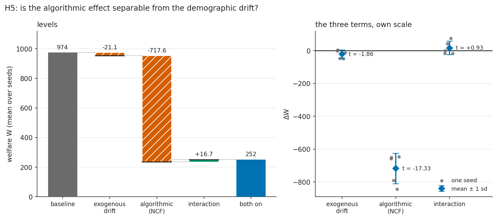
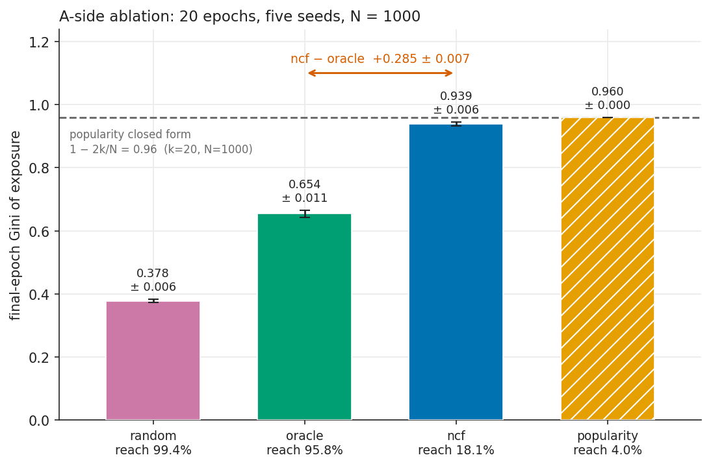
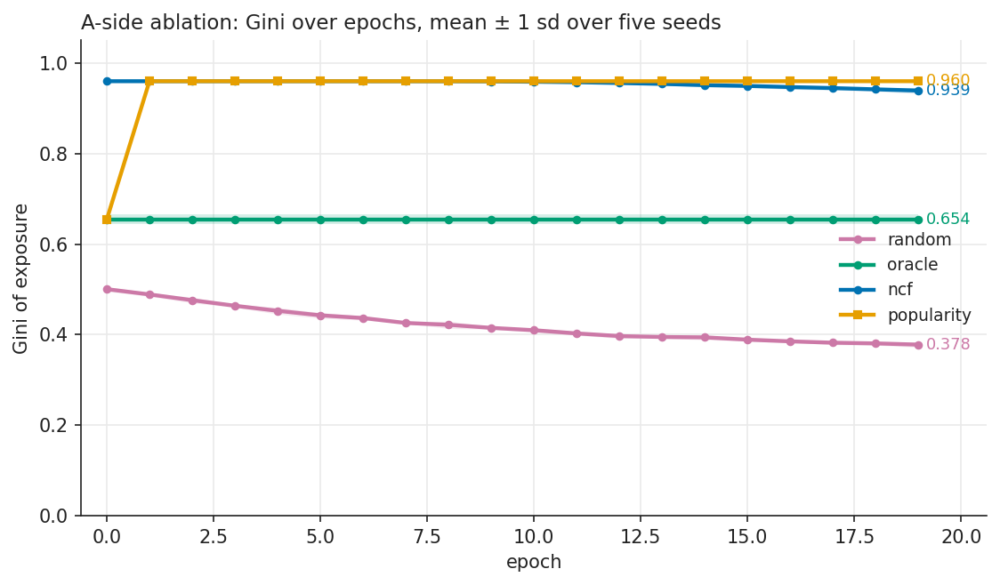
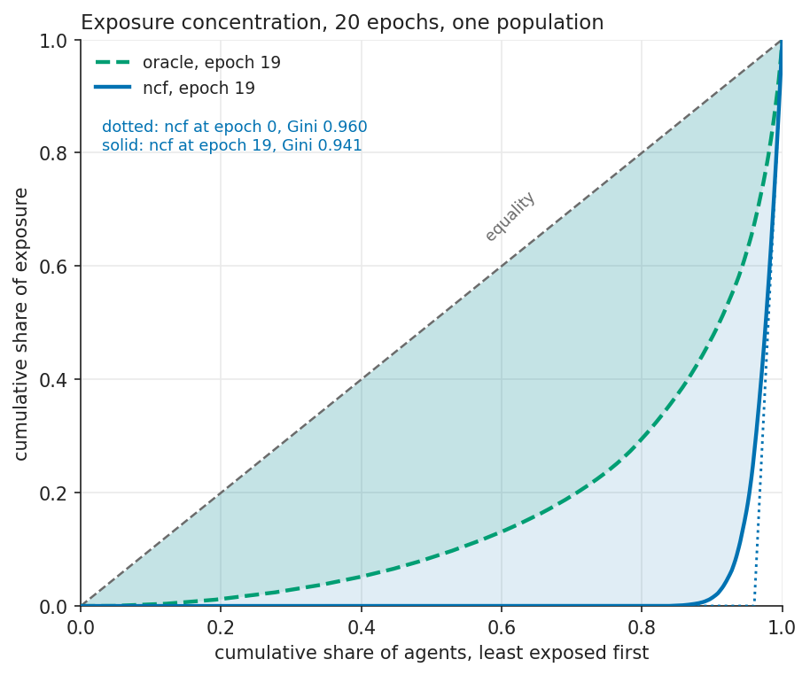
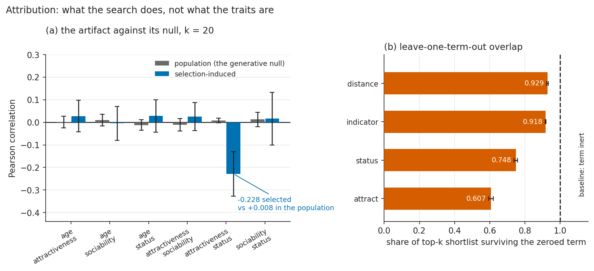

# Hypergamic Matching Markets


A computational study of **matching-market institution design**. It asks a question that is well
defined inside a specified model: when a matching market has a signalling cost, an information
asymmetry over intent, a limited network size, and an enforcement penalty, how does total welfare
depend on those four parameters?

It does not prove anything about any real population. A simulation of a specified utility model
shows what follows from its assumptions; it cannot establish that the assumptions hold. Every claim
below is a comparative static — what moves when one institutional parameter changes with the rest
held fixed — and [docs/THESIS.md](docs/THESIS.md) states the limits explicitly, including six
hypotheses each with a stated condition that would refute it.

The simulation fuses three layers: an Agent-Based Model of heterogeneous agents with asymmetric
utility functions, a Neural Collaborative Filtering engine that mediates visibility, and a
Gale-Shapley market-clearing algorithm.

---

## The two environments

The object of study is the **comparison**, not either market on its own.

| | Environment A | Environment B |
|---|---|---|
| signalling cost $c$ | $\approx 0$ | positive |
| visibility | global, algorithmically mediated | complete within a local subgraph |
| intent inferable from a proposal | no | yes, above a separating threshold |
| defection penalty | 0 | positive (a cost charged after defection, not a deterrent) |
| population | large | small |

Neither is the good one. **A** has liquidity and no information; **B** has information and no
liquidity. The thesis is that welfare is maximized at an interior point, and locating it is the
work.

The mechanism, in one line: an agent proposes only when $\tau_i V_{ij} p > c$, so the pool of
proposers is $\{\tau_i > c/(\bar V p)\}$. At $c = 0$ every type proposes and a proposal carries no
information about intent — Akerlof's pooling outcome, reached through a cost channel. At $c > 0$
low-intent agents filter themselves out — Spence's separating equilibrium. The model's job is to
find the boundary between them and price the liquidity that B gives up.


## The utility model

Each agent $a_i$ carries a state vector $\mathbf{v}_i = [s_i, a_i, c_i, t_i]^\top$ — socio-economic status, attractiveness, sociability, and age. Every trait is z-scored against population statistics before it enters a utility, so the weights below are measured against unit-variance traits and are directly comparable to one another. Hypergamy enters through the utility function agents in $W$ use when evaluating candidates in $M$:

$$U_w(m) = \alpha \cdot \tilde{s}_m + \beta \cdot \tilde{a}_m - \gamma \cdot d(\mathbf{\tilde v}_w, \mathbf{\tilde v}_m) + \lambda \cdot \mathbb{1}[\tilde{s}_m \geq \tilde{s}_w + \delta]$$

The indicator term rewards status surplus $\delta > 0$, encoding the preference asymmetry, and $\delta$ is measured in standard deviations of log-status. The indicator only has force when $\beta/\alpha \geq 2$ — otherwise status dominates and the term is constant across every shortlist — so the base config ships $\alpha = 1.0$, $\beta = 2.0$. See [THEORY.md §2.2](docs/THEORY.md) for the measurements. Agents in $M$ use a symmetric utility with no status threshold. Each epoch, a Neural Collaborative Filtering engine (GMF + MLP) trains on swipe logs and generates truncated preference lists, which are passed to a modified Gale-Shapley algorithm to clear the market.

See [docs/THEORY.md](docs/THEORY.md) for full mathematical formulation and [docs/ARCHITECTURE.md](docs/ARCHITECTURE.md) for system architecture.

---

## Key Metrics

| Metric | What it measures |
|--------|-----------------|
| `welfare_common` | **The headline.** Total welfare over all agents, with Environment B's excluded agents scored at their A outcome |
| `welfare_selected` | Entrants only — reports the selection artifact rather than hiding it, and is never quotable as the headline |
| Gini coefficient $G$ | Exposure inequality across the agent population |
| Market clearing rate | Fraction of agents who receive a match |
| Rank satisfaction index $R$ | How highly agents rank their actual partner |
| Algorithmic loss $\Delta$ | Welfare gap between full-information and NCF-mediated matching |
| Pareto $\alpha$ (per generation) | Tail concentration in cumulative match distribution |
| $\mathbb{E}[\tau \mid \text{proposal}]$ | Mean intent of received proposals — the signal-quality measure (H1) |

The two welfare figures answer different questions and the difference between them,
`welfare_selected − welfare_common`, is itself a diagnostic: when it is large, Environment B's
apparent advantage is mostly the agents it declined to serve. It can also be negative, when B's
own entrants end up worse off than the population; see THEORY.md §10.4.

---

## Installation

Requires CMake 3.18+, Python 3.9+, and a C++17 compiler. See
[docs/PREREQUISITES.md](docs/PREREQUISITES.md) for the Windows toolchain setup — MSVC Build Tools
are needed and are not installed by default.

```powershell
git clone https://github.com/freddysccheung-067/hypergamic-matching-markets
cd hypergamic-matching-markets
python -m pip install -r requirements.txt
cmake -B build -DCMAKE_BUILD_TYPE=Release
cmake --build build --config Release --parallel
```

The compiled extension lands in `build\Release`. Put that directory on `PYTHONPATH` before
importing `src.python`:

```powershell
python -c "import sys; sys.path.insert(0, 'build/Release'); import _hypergamic; print('ok')"
```

## Usage

```python
from src.python.orchestrator import Simulation

sim = Simulation(config_path="experiments/base.yaml")
metrics = sim.run(n_epochs=100)
```

Run a parameter sweep over the hypergamy coefficient:

```powershell
python scripts/run_sweep.py --delta-values 0.0,0.5,1.0,1.5 --output-dir data/processed/
```

Run the institutional comparison (the size × cost grid, the values_min axis and the factorial;
about ten minutes at N = 1000 over five seeds):

```powershell
python scripts/run_institutional.py
```

---

## Repository Structure

```
src/cpp/        Agent state, utility, Gale-Shapley engine (C++17 + OpenMP)
src/python/     NCF model, orchestrator, metrics, visualization (PyTorch)
experiments/    YAML configs for reproducible runs
scripts/        Parameter sweep runner
tests/          C++ (Catch2) and Python (pytest) test suites
notebooks/      Full-pipeline demo notebook
docs/           Mathematical formulation and architecture diagrams
```

**Status: both environments and the comparison are built and measured.** The four ablation arms,
the attribution analysis and every Gini figure in §7 of THEORY.md are **A-side results**, and they
stay A-side results: they describe one institution. The comparison between institutions is in
THEORY.md §10.4–§10.6, and its three findings are below.

### What the comparison found

Measured with `scripts/run_institutional.py`, N = 1000, five seeds (42–46), mean ± sd over seeds.
Every welfare figure is `welfare_common` (every agent counted once, agents Environment B does not
match scored at their Environment A outcome), never the entrant-only figure.

- **H4, the interior optimum: survives, but only at low signalling cost and only against an
  oracle A.** At $c_B = 0.01$, B's advantage over A is not monotone in B's size. It is negative
  for small subgraphs and peaks at size_fraction 0.65 ($|B| \approx 512$): **+64.6 ± 9.9** under
  the conservative (residual) accounting, +166.3 ± 15.9 under §10.4's literal rule, on a base of
  973.7. At $c_B \geq 0.05$ B loses at every size, which is H4's kill condition on that slice. The
  curve's left side is the thin-market penalty; its right side is the top-k truncation of
  THEORY.md §10.5, not the mechanism H4 names. Against an NCF-mediated A, B wins at every size.
- **H5, the factorial decomposition: the interaction is indistinguishable from zero.**
  $\Delta W_{\text{interaction}} = +16.7 \pm 40.4$ (standard error 18.1; per seed −17.0 to +74.2,
  three of five negative), against an algorithmic term of −717.6 ± 92.6 and an exogenous term of
  −21.1 ± 25.3. **The interaction may be zero, and THESIS.md stated this in advance as H5**: drift
  moves traits and the recommender moves visibility, so the two channels are separate by
  construction. The model gives no support for "the algorithm amplifies the demographic shift."
- **The entry filter is a selection trap.** At size_fraction 0.5, raising B's alignment filter from
  0 to 0.5 raises the entrant-only figure relative to the population by 224 and lowers
  welfare_common by 92 (84 under the residual accounting). A reader shown only the entrants would
  see the filter working.

- **H2, threshold inflation as a defence: not testable as shipped, not supported when added.** The
  θ update moves only acceptors who receive a proposal (4–9% of them), and for those it is decay
  toward a yield the calibrated θ is far above; received volume can only lower θ and intent is
  never read. A flooding term added by hand (`hypergamy.flooding_weight`) is visible net of the
  yield step only at its larger weight and k = 20, is weakened rather than ended by a separating
  cost, and at that weight closes a cost-bearing market. See THESIS.md under H2.

Three corrections to the plan in THESIS.md came out of the measurement and are stated in THEORY.md
§10.4: the §10.4 welfare equals the old welfare only when every intent is 1; the entrant-only figure
is *not* always above welfare_common (it goes negative when B's cost or thinness makes entrants
worse off); and the literal comparability rule can count an A match whose partner is busy in B, so
a feasible "residual" version is reported beside it.

### The three figures

Generated by `scripts/make_figures.py`; regenerate with `python scripts/make_figures.py`. Each
caption states what the figure does *not* show, because in every case that is at least as
important as what it does.



**Figure 1 — H1.** Points are $E[\tau \mid \text{proposal}]$ against the signalling cost, ±1 sd over
five seeds. The mean rises with $c$, so the cost does select on intent. It sits *below* the pure-cut
line because the decision compares $\tau V_{ij} p$ with $c$ pair by pair and $V_{ij}$ varies, so a
low-intent agent can still clear it against a high-value candidate. *What it does not show:* that
real proposers face this cost or this utility scale, or that the assumed accept rate is the one the
market produces — the decision is handed $p = 0.5$, the epoch-0 prior, while measured reciprocity is
0.013–0.041. The curve is a statement about epoch 0 under that prior: with the measured rate carried forward, a market running for more than one epoch closes for good near $c = 0.07$.



**Figure 2 — H4.** Welfare against the share of the population in Environment B. Solid is
`welfare_common` (the number the thesis rests on); dashed is the entrant-only figure, and the gap
between them is the selection artifact — which changes sign and is therefore neither a conservative
nor an optimistic bound. *What it does not show:* that any real community is at the implied size;
that the optimum survives a higher cost (right panel, $c_B = 0.05$, is the kill condition: B never
beats A) or an NCF-mediated A (against which B wins at every size); or that both slopes are the
thin-market penalty — the right-hand slope is top-$k$ truncation, so $N^*$ locates the left one only.



**Figure 3 — H5.** Left: welfare as a waterfall from baseline through exogenous drift, NCF
mediation, and their interaction. Right: the three terms on their own scale, since the algorithmic
term is large enough to hide the other two. *What it does not show:* that algorithms amplify
anything. That claim would need a non-zero interaction, and this one has $t \approx 0.9$ on 4 df with
the sign changing across seeds. The algorithmic bar is estimation error against an oracle, not a
measurement of any deployed recommender.

### The A-side figures

The first half of the project measured one institution. These four figures are those results.



**Figure 4 — the ablation.** Final-epoch Gini for the four ranking rules on one population, seed and
utility set. Measured over five seeds: NCF 0.939 ± 0.006, oracle 0.654 ± 0.011, random 0.378 ± 0.006,
popularity 0.960 ± 0.000. The dashed line is the popularity arm's closed form, $1 - 2k/N$, and that
bar sits on it to the third decimal with zero variance — it is arithmetic, not a finding. *What it
does not show:* that unequal exposure is harm. The oracle, the best available ranker on its own
task, also concentrates; and the random arm is lowest *by construction*, since uniform sampling
gives a near-equal profile. The comparison that carries the argument is NCF minus oracle
(+0.285 ± 0.007), not NCF minus random.



**Figure 5 — Gini over time.** One line per arm, mean ± 1 sd across seeds, with generation breaks
read from the run's own `generation` column. The popularity arm jumps from the oracle's 0.654 at
epoch 0 to its closed form at epoch 1 — the first epoch has no in-degree history, so it falls back
to the true-utility ranking. *What it does not show:* feedback in the A-side numbers. These runs use
`admissible_fraction 0.2`, where the θ gate never binds, so the market does not respond to its own
outcomes. An upward slope here is preference concentration in a static market, not a loop. The
shipped config now uses 0.02, at which the gate does bind; the two regimes are compared in
`data/processed/ablation/` and `data/processed/ablation_live/`.



**Figure 6 — the Matthew effect.** Cumulative share of exposure against cumulative share of agents,
for the oracle and the NCF on the same population. The NCF's curve hugs the axis almost to the
right edge: a few percent of agents receive nearly all the exposure. *What it does not show:* that
users would behave differently if shown a different list. `generate_swipes` takes no shown-set
argument, so preferences never respond to exposure.



**Figure 7 — attribution.** Left: the correlation an analyst would measure among selected pairs
(blue) beside the generative correlation in the population (grey), for each trait pair. Status and
attractiveness correlate −0.23 among selected pairs and +0.008 in the population: the gap is the
artifact. Right: how much of each agent's top-20 survives zeroing one term, so a low bar means that
term drives selection. Attractiveness (0.607) ranks below status (0.748) in *visibility* but above it
in *influence* here, because $\beta = 2\alpha$ on standardized traits. *What it does not show:* that
any trait causes another. They are drawn independently; the correlation is a property of the search.

## Limitations

This is a model of a mechanism, not a measurement of a population. The distinction matters most
for attractiveness, so it gets its own note.

**Every trait is synthetic.** Status, attractiveness, sociability and age are drawn from
distributions chosen for tractability. Nothing here estimates a real quantity, and no output says
anything about an actual person.

**Attractiveness is not measurable on the scale the model uses.** Three separate problems, and the
model only absorbs the first:

- *Self-report compression.* People cluster near the top of the scale — a 7/10 rather than a 5/10
  for someone who feels average. A shift shared by everyone is an intercept and cancels in a
  ranking comparison, so this is less damaging than it looks. What it destroys is usable variance:
  if everyone reports 7, the term carries no information.
- *Rank scales are ordinal, not interval.* A 7 and a 5 are labels, not measurements. Treating them
  as reals assumes comparable gaps between them, which nothing in how they are elicited supports.
- *There is no absolute scale.* A 7 in one city, age group or app is a 5 in another. Any empirical
  calibration would have to name its reference population.

Because traits are standardized before entering the utility, only the *rank order* of
attractiveness matters — the specific 0–1 scale and the self-report question cancel. What the
model cannot survive is a distribution with no variance, which heavy compression would produce.
That is why the default is not a self-report-shaped distribution: a term that barely varies cannot
test anything. The results should be read as an upper bound on how much attractiveness can
influence selection, not as an estimate of how much it does.

**The Matthew effect needs its control.** A rising Gini under the recommender proves nothing on
its own — preferences alone concentrate attention. The claim this project supports is a difference
between arms sharing the same population, seed and utilities, never `Gini(NCF)` reported alone.
The quantity that carries the argument is `Gini(NCF) − Gini(oracle)`: what estimation error costs
relative to a ranker that solves the same task perfectly. It is *not* `Gini(NCF) − Gini(random)`,
which mostly measures distance from uniform exposure — the random arm has the lowest Gini of the
four by construction, not because uniform exposure is the goal. Measured over five seeds: NCF
0.9393 ± 0.0065, oracle 0.6544 ± 0.0109, random 0.3780 ± 0.0058, popularity 0.9600 ± 0.0000 (a
closed form, `1 − 2k/N`, with no variance).

Which term does the concentrating is a separate question, and the answer is not simply "status".
Leave-one-term-out at the shipped weights (`docs/attribution.md`) puts attractiveness ahead of
status — overlap 0.607 against 0.748 at k=20 — because `beta = 2·alpha` and both traits are
standardized, so the attractiveness term carries twice the linear influence by construction. That
is a property of this weight set and these distributions, not an intrinsic ranking of traits, and
THEORY.md §9.2 states the qualification in full.

**Preferences do not respond to exposure; selectivity does.** This is an exposure-mediated model in
one direction only. `generate_swipes` takes no shown-set argument, so what the recommender surfaced
never shapes what anyone wants and the Matthew effect is not compounded by a feedback loop through
preferences. A separate loop does exist — the matching outcome moves the acceptance threshold θ,
which gates the next epoch's swipe set. Whether that loop binds depends on `admissible_fraction`:
θ can only truncate when the admissible set is shorter than the shortlist (`phi < 2k/N`), which at
k=20, N=1000 is 0.04. The config now ships 0.02, so the loop is live; the A-side results reported
above were measured at 0.2, where it was inert, and are labelled as such.

**Correlation among matched pairs is a selection artifact.** Traits are drawn independently, so no
trait causes another. The market sorts on several at once, which makes the survivors correlate at
the top of the distribution. That is selection, not a finding about individuals, and the sign is
not the intuitive one: measured at the shipped config, status and attractiveness correlate
−0.25 ± 0.13 among top-10 shortlisted pairs against +0.008 in the population, because among
candidates clearing a high bar, higher status comes with lower attractiveness on average. The gap
between the two columns is the artifact; the population column is the fact. See THEORY.md §9 and
`docs/attribution.md`, which is generated by `scripts/run_attribution.py` and reports every figure
as a mean ± sd over independent populations — one market's top-10 coefficient varies from −0.06 to
−0.38 across draws and is not quotable on its own.

**Algorithmic loss cannot cleanly measure the recommender.** Agents carry two kinds of preference
heterogeneity: per-agent taste multipliers, which a collaborative filter can in principle learn, and
persistent pairwise "chemistry" — an independent logistic draw for every ordered pair, which no
learner can. The full-information benchmark ranks by true utility and therefore includes the
chemistry; the NCF only ever sees the learnable part. So the gap between them carries an irreducible
component even for a perfect recommender. Read algorithmic loss as an upper bound on what a
recommender costs the market, never as a score of the NCF, and report it with the noise-to-signal
ratio it was measured at (computed once per run and logged from `utility_sd`).

**Two knobs have no empirical anchor.** `population.taste_sigma` (the spread of the taste
multipliers) and `hypergamy.shock_scale` (the scale of the pairwise chemistry, in absolute utility
units) are modeling choices, not estimates; nothing here measures how much real preferences vary.
They are set to be visible at the base weights and nothing more. Every headline result is therefore
reported as a function of them, never at one setting, and the concentration-versus-heterogeneity
curve is part of the result: with both at zero only 6.9% of agents appear on anyone's shortlist and
the visibility Gini is 0.958; at the base values those become 95.5% and 0.664.

**Market clearing rate is not comparable across population sizes.** At fixed $k$, MCR falls roughly
as $1/N$ — 0.37 at $N=500$ against 0.10 at $N=4000$ with $k=20$. The ceiling is of order $k^2/N$
once shortlists spread out, and of order $2k/N$ only in the fully concentrated market where every
shortlist holds the same people, so the scaling law itself depends on the heterogeneity knobs.
Comparing across $N$ requires scaling $k$ with $\sqrt{N}$, at which point the rate is close to flat
(0.27, 0.27, 0.26, 0.24 across the same four sizes). That choice makes the swipe log grow as
$N^{1.5}$ rather than $N$, which the training budget has to absorb.

**Other limits.** The full-information benchmark is capped near N=5000 for memory reasons.
M-proposing Gale-Shapley returns the proposer-optimal matching, which is the *worst* stable
outcome for the acceptor side. Reported W-side rank satisfaction is therefore a lower bound across
stable matchings rather than a central estimate; the full-information versus NCF comparison uses
the same direction in both arms, so the gap between them is far less affected than the absolute
level. Generational turnover is the only population dynamic; there is no entry,
exit or preference learning from outside the simulation.

## License

MIT
