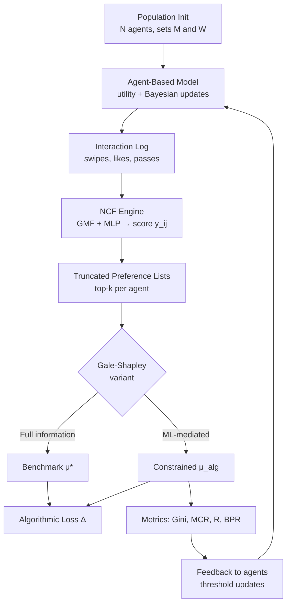
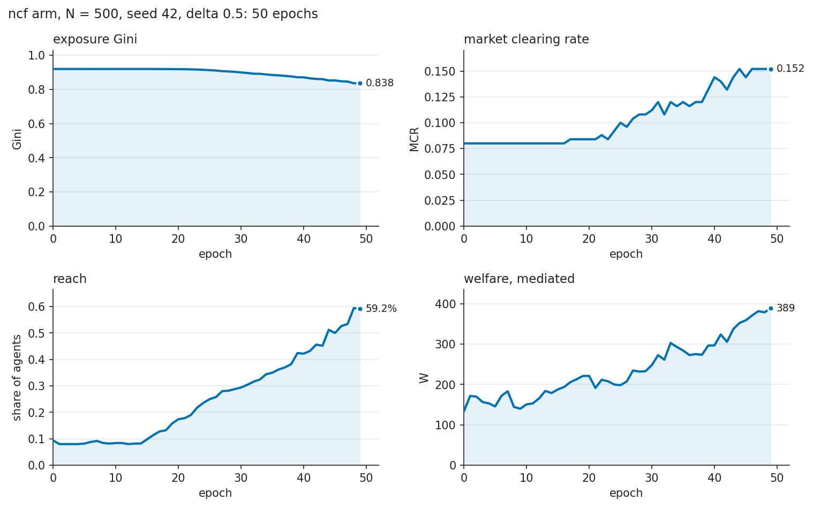
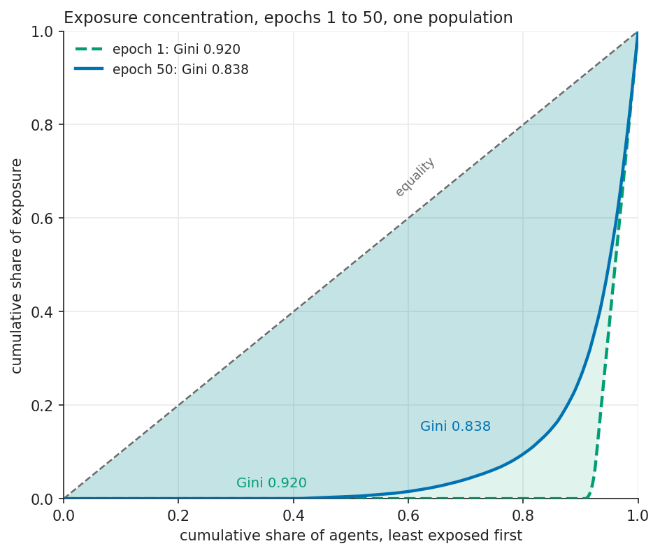
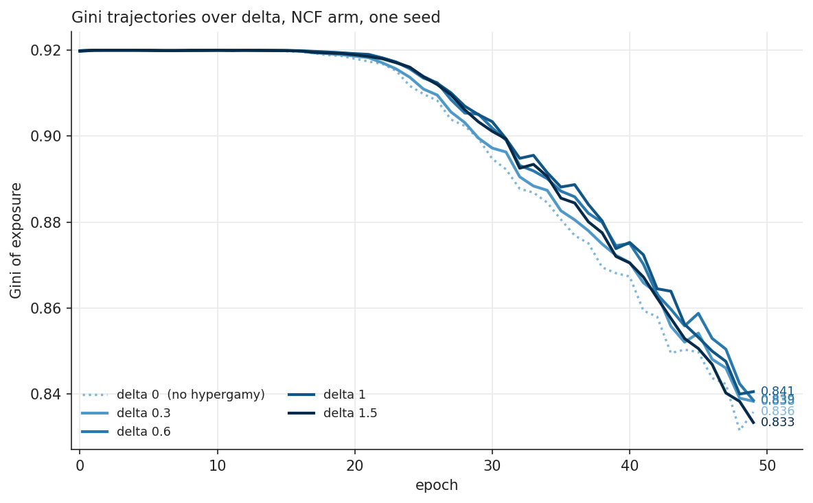

# Hypergamic Matching Markets

[](https://github.com/freddysccheung-067/hypergamic-matching-markets/actions/workflows/ci.yml)


Hypergamy is the requirement that a partner rank at or above you on status, not merely beside you.
It is easy to state as a preference and hard to price, because once a recommender sits between the
two sides of a market it decides which candidates anyone ever sees — and a preference that operates
on a truncated list is not the same preference that operates on the whole population.

So the question here is narrow and answerable: **what happens to a matching market when an
engagement-optimizing recommender sits between the two sides?** Five values of the status-surplus
threshold, one Neural Collaborative Filtering ranker, a Gale-Shapley clearing step, fifty epochs at
500 agents. Every number below traces to a committed figure or a committed run.

This is a model of a mechanism, not a measurement of a population. Simulating a specified utility
model shows what follows from its assumptions; it cannot show that the assumptions hold. Everything
reported is a comparison between arms sharing a population, a seed and a utility set.

---

## The Model

Three layers in a loop. Each epoch: agents form preferences, an ML engine decides what is visible, a
matching algorithm clears the market, and the outcome feeds back into what agents expect next time.

**Agent layer.** Agents split into a proposer side `M` and an acceptor side `W`, each carrying a
state vector `[s, a, c, t]` — socio-economic status, attractiveness, sociability, age. Status is
drawn lognormal, the rest clipped to `[0, 1]`, and every trait is z-scored against population
statistics before it reaches a utility, so the utility weights are measured against unit-variance
traits and compare directly. In the demo population status has median 0.96 and a maximum of 7.47;
attractiveness spans 0.01 to 0.96.

**Recommender layer.** A GMF + MLP collaborative filter trains on the swipe log — 97 swipes per
agent per epoch at this size — and scores every unseen pair. Each agent keeps a top-20 shortlist
from those scores, and nothing else is visible to the matching step. That is the point of the
experiment: the filter is not a convenience wrapper around a preference list, it *is* the
preference list.

**Matching layer.** A truncated deferred-acceptance pass clears the market over those shortlists, in
C++ with OpenMP, returning who matched with whom and a blocking-pair count. A full-information arm
ranks by true utility under the same direction, giving the benchmark that algorithmic loss is
measured against.



The acceptor side `W` evaluates candidates in `M` with

$$
U_w(m) = \alpha \cdot \tilde{s}_m + \beta \cdot \tilde{a}_m - \gamma \cdot d(\mathbf{\tilde v}_w, \mathbf{\tilde v}_m) + \lambda \cdot \mathbb{1}[\tilde{s}_m \geq \tilde{s}_w + \delta]
$$

The last term pays `λ` only when the man's standardized status clears the woman's by `δ` standard
deviations of log-status — a one-sided reward for surplus with no counterpart in `U_m(w)`, which
uses the same form at `δ = 0`. That indicator is the entire model of hypergamy: the two sides are
otherwise identical, so whatever the market does differently on the two sides is exactly this term.

`δ` is inert unless `β/α ≥ 2`. When status dominates the linear terms the shortlist is a status
prefix, the indicator is constant across it, and no value of `δ` reorders anything. Measured
top-1000 overlap between `δ = 0` and `δ = 1` is 0.9978 at `β/α = 0.1` and 0.7615 at the shipped
`α = 1.0, β = 2.0`; `tests/cpp/test_delta_power.cpp` fails if a retune pushes that overlap back
above 0.95, and asserts exact inertness when status is the only signal so the guardrail cannot pass
vacuously.

## The two environments

The recommender is one of two institutions the repository compares. Environment A is the market
above; Environment B is a small subgraph of the same population with a signalling cost, complete
visibility inside it and an entry filter on values.

| | Environment A | Environment B |
|---|---|---|
| signalling cost `c` | ≈ 0 | positive (shipped 0.25; grid 0.01–0.25) |
| visibility | global, recommender-mediated | local subgraph, complete within it |
| intent `τ` | not observable | not observable, partly separated by cost |
| defection penalty `d` | 0 | positive (shipped 0.5) |
| population | `N` | at most `size_fraction · N`, after the entry filter |

At `c = 0` every type proposes, so a proposal says nothing about intent: Akerlof's pooling outcome.
At `c > 0` only types with `τ > c / (V̄ · p)` propose, so a proposal carries information: Spence's
separating outcome. The thesis is that welfare is maximized at an interior point, with information
gained against liquidity lost. Measured against an oracle Environment A over five seeds
(`data/processed/institutional/grid_summary.csv`, `welfare_diff_residual`), that holds at `c = 0.01`
only: the gain peaks at `size_fraction` 0.65 at +64.6 ± 9.9 and is −10.8 at 0.05. At `c ≥ 0.05` the
best cell is no better than zero (+0.23 ± 5.8 at `c = 0.05`), and against an NCF-mediated A the
ordering changes. [docs/THESIS.md](docs/THESIS.md) states H4 and H5 with their kill conditions, and
THEORY §10 and `data/processed/institutional/README.md` give the accounting.

## Results

Figures come from `scripts/make_figures.py` and the demo notebook. Quoted numbers are from the demo
run: N = 500, seed 42, 50 epochs, `δ = 0.5`. This is the live regime, `admissible_fraction = 0.02`.



**The run itself.** Four measures against epoch on one population. The welfare panel shows the
mediated series only; the full-information benchmark (2170.3) is off its scale and is quoted below.



**The Matthew effect, epoch 1 against epoch 50.** Same population, so the only thing that moved is
exposure — and the curve moves *toward* equality, because epoch 1 is the cold-start state where
every agent receives nearly the same ranking.



**The hypergamy sweep.** Five values of `δ` from 0 to 1.5, five separate runs on one seed. `δ`
changes who matches; it barely changes exposure concentration, which the ranking rule dominates.

Headline numbers, read off the committed output:

- **Algorithmic loss 0.821.** Mediated welfare at epoch 50 is 389.0 against a full-information
  benchmark of 2170.3 on the same population — the filter recovers 17.9% of what a ranker that knows
  true utilities would.
- **Exposure Gini falls 0.920 → 0.838 over 50 epochs while reach rises 9.4% → 59.2%**, and the top
  1% of agents hold 12.5% of exposure at epoch 1 against 11.9% at epoch 50. The same movement read
  twice: what looks like concentration easing is the recommender learning coverage, and the
  concentration that remains is a cold-start property, not something the loop compounds.
- **The NCF–oracle exposure gap is a cold-start effect.** At N = 1000, k = 20, five seeds, the
  shipped regime (`admissible_fraction = 0.02`): the Gini gap is +0.287 ± 0.010 at epoch 19 and
  +0.025 ± 0.008 at epoch 99, positive on every seed (`data/processed/ablation_live/` and
  `ablation_h100/`). The 20-epoch figure of +0.285 measured at `admissible_fraction = 0.2`
  (`data/processed/ablation/`) is the same effect in the inert regime. Quote the horizon with it.
- **`δ` moves matching without moving concentration.** Across `δ = 0 → 1.5` the final-epoch Gini
  stays inside a 0.007 band (0.8334–0.8405), shortlist overlap against `δ = 0` falls to 0.8528
  (about three entries of a twenty-item list turn over), and rank satisfaction runs 0.4769 at `δ = 0`
  to a peak of 0.5411 at `δ = 1.0`, back to 0.4890 at 1.5. Clearing rate goes 0.156 → 0.180 at
  `δ = 1.0`, 0.164 at 1.5.
- **Over four generations Pareto α falls 0.499 → 0.383** as turnover replaces 100 agents per
  generation, with clearing rate rising 0.080 → 0.112.

## Installation

Windows is the development environment, so these are PowerShell commands; apart from the toolchain
they work unchanged on Linux and macOS. You need CMake 3.18+, Python 3.12 and a C++17 compiler. On
Windows the compiler is **not** installed by default — MSVC Build Tools are required, and
[docs/PREREQUISITES.md](docs/PREREQUISITES.md) walks through getting them.

```powershell
git clone https://github.com/freddysccheung-067/hypergamic-matching-markets
cd hypergamic-matching-markets
python -m venv .venv
.venv\Scripts\Activate.ps1        # PowerShell;  source .venv/bin/activate on POSIX
python -m pip install -r requirements.txt
cmake -B build -DCMAKE_BUILD_TYPE=Release
cmake --build build --config Release --parallel
```

Use the virtual environment: the pins in `requirements.txt` are exact and the simulation's numbers
depend on them, so installing into a global interpreter would downgrade whatever is already there.
The extension lands in `build\Release` as `_hypergamic.cp312-win_amd64.pyd`. It is not installed into
site-packages, so Python needs to be told where it is before anything imports the simulation:

```powershell
python -c "import sys; sys.path.insert(0, 'build/Release'); import _hypergamic; print('ok')"
```

The notebook does this walk-up itself. Everything else needs the insert first, or
`$env:PYTHONPATH = "build\Release"` for the session.

## Usage

The snippet below is the run whose numbers appear under Results: N = 500, 50 epochs, the live
regime.

```python
import yaml
from src.python.orchestrator import Simulation

with open("experiments/base.yaml", encoding="utf-8") as fh:
    config = yaml.safe_load(fh)
config["population"]["n"] = 500

sim = Simulation(config=config, recommender="ncf")
df = sim.run(50)
```

`experiments/base.yaml` itself ships N = 1000 and `n_epochs: 100`.

`Simulation` takes `config=` (a dict or `SimConfig`) or `config_path=` (a YAML file, defaulting to
`experiments/base.yaml`), and `recommender=` picks the arm (`"ncf"`, `"oracle"`, `"random"`,
`"popularity"`). `run` returns one row per epoch: Gini, clearing
rate, rank satisfaction, both welfare figures and the algorithmic gap.

Sweep the status threshold:

```powershell
python scripts/run_sweep.py --delta-values 0.0,0.5,1.0,1.5 --output-dir data/processed/
```

Run the whole pipeline end to end — N = 500, 50 epochs, as in the figures above:

```powershell
python -m jupyter lab notebooks/demo.ipynb
```

Start the notebook on the project's own interpreter (`.venv`). The numbers depend on the pinned
torch and numpy, and a different stack gives slightly different results from the same seed.

## Limitations

In rough order of how much they constrain what the results can mean.

**Every utility is synthetic, with no learned real-world weights.** Status, attractiveness,
sociability and age are drawn from distributions chosen for tractability. Nothing is calibrated to
a dataset. The results bound what this mechanism *can* do under a stated utility; they say nothing
about whether any population sits at these parameters.

Because traits are z-scored before entering a utility, only the rank order of a trait matters — but
a distribution with no variance would still destroy the term. The default is deliberately not
self-report-shaped for exactly that reason, so read the attractiveness results as an upper bound on
its influence, not an estimate of it.

**The full-information benchmark is capped at N = 5000** for memory reasons: it materializes an
`O(N²)` preference matrix. Past that the benchmark arm cannot run, so large-N results are NCF-only
and lose their reference.

**W-side rank satisfaction is a lower bound, not a central estimate.** M-proposing Gale-Shapley
returns the proposer-optimal matching, which is simultaneously the acceptor-pessimal one: among all
stable matchings, every `W` receives her worst. On the cyclic 3×3 in `tests/cpp/test_matching.cpp`,
M-proposing leaves every woman with her last choice (sum of ranks 6) where W-proposing gives every
woman her first (sum 0). Hypergamy lives in `W`'s utility, so this lands on exactly the side the
project is about. The full-information versus NCF comparison uses the same direction in both arms,
so the *gap* is far less affected than the absolute level. Never compare a W-side level against a
W-proposing baseline without saying so. See
[docs/INTERFACES.md §5](docs/INTERFACES.md) for the derivation and for the W-proposing sensitivity
check.

**No dynamic entry or exit beyond generational turnover.** Nobody joins or leaves the market in
response to outcomes, so there is no selection at the extensive margin, and a market that got bad
enough to empty out could not show it.

**Preferences do not respond to exposure.** `generate_swipes` takes no shown-set argument, so what
the recommender surfaces never shapes what anyone wants and the Matthew effect is not compounded by
a feedback loop through preferences. A separate loop does exist — matching outcomes move the
acceptance threshold `θ`, which gates the next epoch's swipe set — but it only binds when
`φ < 2k/N`, about 0.04 at k=20, N=1000. The config ships 0.02, so it is live; results measured at
0.2 are labelled as inert in the docs.

**Two knobs have no empirical anchor.** `population.taste_sigma` and `hypergamy.shock_scale` are
modeling choices, not estimates. With both at zero only 6.9% of agents appear on anyone's shortlist
and the visibility Gini is 0.958; at the base values those become 95.5% and 0.664. Headline results
are reported as a function of them, never at one setting.

**Market clearing rate is not comparable across population sizes** at fixed `k`: it falls roughly as
`1/N`, 0.368 at N=500 against 0.101 at N=4000 with k=20. Scaling `k` with `√N` flattens it (0.268,
0.270, 0.255, 0.238 across N = 500, 1000, 2000, 4000) but makes the swipe log grow as `N^{1.5}`
([THEORY.md §7.2](docs/THEORY.md)).

**Closed-form results already exist for the one-dimensional case.** E. Bilderbeek, *Hypergamy Is
Solved* (23 October 2026), proves the equilibrium results for a single scalar status. The simulator
reproduces Theorem 2.2's deficit `D` and Theorem 3.3's height deficit to within `1/N` per seed
(`D` exactly, on a sample; the height deficit about 0.004–0.005 above the population value, the
expected upward bias of a sample supremum), and Theorem 5.1's assortative uniqueness, with zero
blocking pairs in both proposer directions ([docs/validation.md](docs/validation.md)). These are two
different checks. `D` and the height deficit are maximum-cardinality bipartite matchings
(`scipy.sparse.csgraph.maximum_bipartite_matching`) under a compatibility constraint and say nothing
about stability; Theorem 5.1 is the stability result and is tested with `deferred_acceptance`. So
this project does not claim priority over a proved result. What it adds is the
recommender-intermediated, multi-trait setting that the paper's Section 9 names as open, where
visibility is a truncated top-k list over an estimated utility and no closed form is known.

## Documentation

- [docs/THESIS.md](docs/THESIS.md) — what the repository is about, the two environments, and the six hypotheses with their kill conditions
- [docs/THEORY.md](docs/THEORY.md) — full mathematical formulation, including §10 on the institutional model
- [docs/validation.md](docs/validation.md) — checks against the closed-form results of Bilderbeek (2026)
- [docs/PERFORMANCE.md](docs/PERFORMANCE.md) — profile of the run loop and the two optimisations that came out of it
- [docs/ARCHITECTURE.md](docs/ARCHITECTURE.md) — layer diagram, dual-language split, per-epoch data flow
- [docs/INTERFACES.md](docs/INTERFACES.md) — the authoritative C++/Python contract, including §5 on proposer direction
- [docs/PREREQUISITES.md](docs/PREREQUISITES.md) — toolchain setup, Windows-first

## License

MIT
