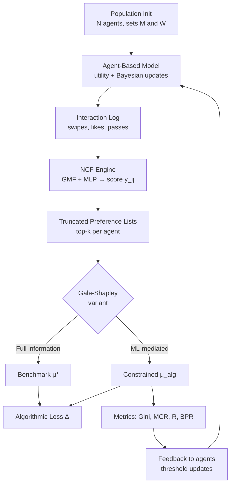

# Architecture

## System Overview

A closed-loop simulation that fuses three computational layers. Each epoch runs the same pipeline: agents form preferences → an ML engine mediates visibility → a matching algorithm clears the market → outcomes feed back into agent expectations.



## Dual-Language Split

Performance-critical loops live in C++; tensor ops and visualization live in Python. They talk through Pybind11.

| Layer | Language | Why |
|-------|----------|-----|
| Agent state + utility | C++ | Tight inner loop, called O(N²) per epoch |
| Population init + distributions | C++ | One-time cost, keeps data local to the engine |
| Gale-Shapley matching | C++ | Graph traversal, cache-friendly adjacency |
| Simulation epoch loop | C++ (OpenMP) | Parallelizable across agents |
| NCF model | Python (PyTorch) | Mature autograd, easy training loop |
| Metrics + statistics | Python (NumPy/SciPy) | Gini, Pareto fits, rank satisfaction |
| Visualization | Python (Matplotlib) | Plots and animations |

## Data Flow Per Epoch

```
 ┌─────────────┐   state vectors   ┌─────────────┐
 │  Population │ ───────────────▶ │  Utility    │
 │  (C++)      │                  │  Engine (C++)│
 └─────────────┘                  └──────┬──────┘
        ▲                                │
        │ threshold update                │ utilities
        │                                ▼
 ┌───────┴──────┐                  ┌─────────────┐
 │  Feedback    │ ◀── metrics ──── │  Swipe Log  │
 │  (C++)       │                  │  (CSV/npz)  │
 └─────────────┘                  └──────┬──────┘
                                         │
                                ┌────────▼─────────┐
                                │  NCF (Python)     │
                                │  train + predict  │
                                └────────┬─────────┘
                                         │ top-k scores
                                ┌────────▼─────────┐
                                │  Preference Lists │
                                │  P_i (truncated)  │
                                └────────┬─────────┘
                                         │
                                ┌────────▼─────────┐
                                │  Gale-Shapley    │
                                │  (C++)            │
                                └────────┬─────────┘
                                         │ matching μ_alg
                                    metrics
```

## Module Boundaries

### C++ side (`src/cpp/`, headers in `include/`)
- `agent.{h,cpp}` — state vector, utility function, threshold update
- `population.{h,cpp}` — distribution sampling, population container
- `matching.{h,cpp}` — Gale-Shapley (full + truncated variants), blocking-pair check
- `simulation.{h,cpp}` — epoch orchestration, OpenMP parallel regions
- `bindings.cpp` — Pybind11 surface exposing the above to Python

### Python side (`src/python/`)
- `ncf.py` — GMF+MLP model, training loop, top-k inference
- `orchestrator.py` — drives one epoch: call C++ sim → log → train NCF → match
- `metrics.py` — Gini, clearing rate, rank satisfaction, algorithmic loss, Pareto fit
- `visualization.py` — static plots and epoch animations
- `config.py` — dataclass holding all hyperparameters (α, β, γ, δ, k, N, T, η)

## Interface Contract (Pybind11)

```cpp
// Exposed to Python
py::dict run_epoch(const py::dict& config, py::array_t<double> states,
                   py::array_t<int> swipe_log, int epoch);
py::array_t<int> gale_shapley(py::array_t<int> pref_lists, int k,
                              bool full_info);
py::array_t<double> sample_population(int n, const py::dict& dist_params);
```

Python passes NumPy arrays in; C++ returns NumPy arrays out. No copies across the boundary where possible (use `py::array_t` with `py::array::c_style`).

## Scalability Targets

| Population | Epochs | Wall-clock target | Bottleneck |
|-----------|--------|-------------------|------------|
| 1,000 | 50 | < 30 s | NCF training |
| 10,000 | 100 | < 5 min | Utility eval + NCF |
| 100,000 | 100 | < 10 min | Memory bandwidth, NCF inference |

## Configuration Surface

All experiment parameters live in one YAML file (`experiments/base.yaml`), loaded into the `config.py` dataclass. Parameter sweeps override individual keys. This keeps experiments reproducible and diffable.
